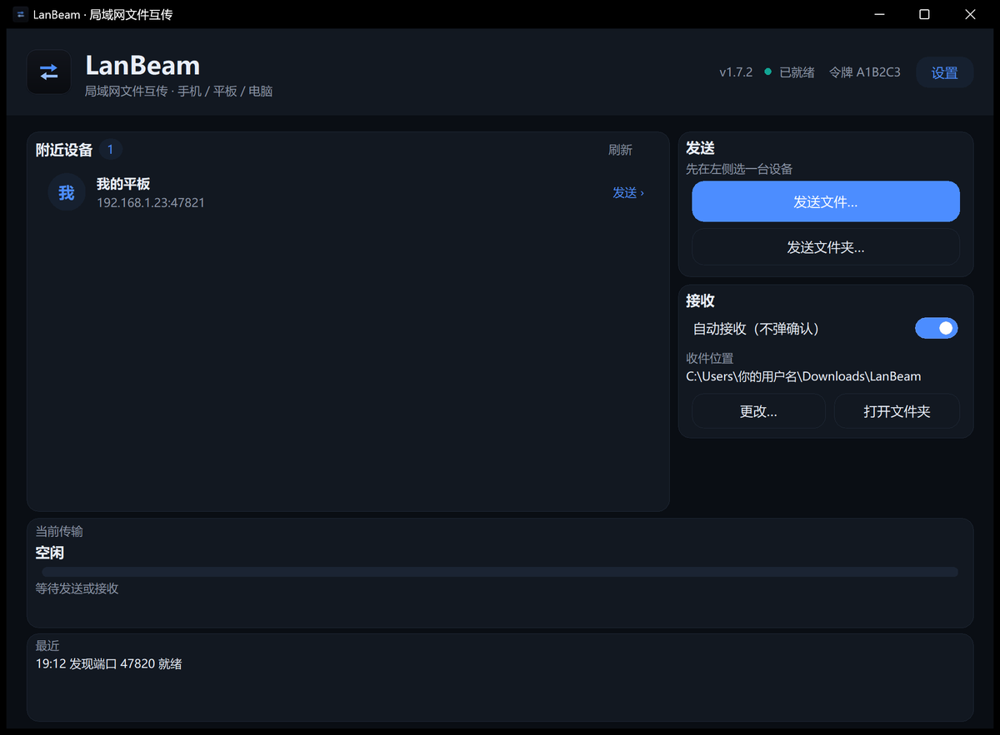

# LanBeam · 局域网文件互传

> 同一 Wi-Fi，双击就传。Windows 10 / 11 · Android 7.0+ · 免安装 · MIT

LanBeam 是一个跑在 Windows 上的局域网传文件小工具：两台电脑连同一个 Wi-Fi（或同一个交换机），各自打开它，左边两秒内就会出现对方。选中 → 发送文件或文件夹 → 对方点「是」，内容落在对方的 `下载\LanBeam`。

不装客户端、不注册账号、不限大小、不过任何服务器。手机端（Android）在同目录的 Releases 里，同一套协议，和电脑互相收发。

**项目页面**：[https://wwwh793.github.io/lanbeam/](https://wwwh793.github.io/lanbeam/)



## 特性

- **免安装单文件**：一个 exe，约 29 MB，双击就跑；不写系统服务，删了即净。
- **断点续传**：按「路径 + 大小」算指纹，断了重发会问对方收到哪了，从断点接着传。
- **文件夹原样保留**：嵌套目录、空目录、中文名都照原样建出来。
- **后台也在收**：点 × 收进托盘继续接收；再双击 exe 把窗口叫回来（单实例，不会开第二个）。
- **开机自启**：可选，启动后直接藏进托盘。
- **右键直接发**：资源管理器里右键文件/文件夹 →「通过 LanBeam 发送」，程序没开也会自己起来。
- **三套主题**：深色 / 浅色 / 跟随系统，开 DPI 感知，高分屏不发虚。
- **开源 MIT**：传输内核与界面分层，协议文档齐全。

## 下载

到 [Releases](https://github.com/wwwh793/lanbeam/releases) 下载：

- **Windows**：[v1.7.2](https://github.com/wwwh793/lanbeam/releases/tag/v1.7.2) 的 `LanBeam.exe`，或者带使用说明的完整包；
- **Android**：[Android 1.0.0](https://github.com/wwwh793/lanbeam/releases/tag/android-v1.0.0) 的 `LanBeam-1.0.0.apk`（Android 7.0+，约 81 KB）。

- 未签名，首次运行若被 SmartScreen 拦下：点「更多信息」→「仍要运行」。
- 需要 Windows 10 / 11（64 位）。不需要管理员权限。

## 怎么用

1. 两台电脑连同一个网络，各自双击 `LanBeam.exe`；首次运行防火墙提示选「允许访问」。
2. 左边列表出现对方后，点中它：
   - 「发送文件…」可以一次多选；
   - 「发送文件夹…」保留目录结构，空目录也会建出来。
3. 对方点「是」，内容进他的 `下载\LanBeam`。想免确认就在设置里打开「自动接收」。

**对方能收不能发？** 是他那边防火墙拦了入站。在**对方**电脑上关掉 LanBeam，右键「放行防火墙（管理员运行）.bat」以管理员运行，再重开。

**看不到对方？** 访客 Wi-Fi 常开 AP 隔离；换主网络，或用「手动添加」填对方的 IP:端口 + 令牌。

## 端口与协议

| 用途 | 端口 | 说明 |
|---|---|---|
| 设备发现 | UDP 47820 | 每 2 秒广播一次；端口被占用时退到临时端口并靠单播回执 |
| 文件传输 | TCP 47821 | HTTP/1.1 分块上传，Token 鉴权 |

协议细节（报文、错误码、路径清洗、续传算法）见 [PROTOCOL.md](PROTOCOL.md)。

## 从源码运行

需要 Python 3.13（Windows 自带 tkinter），没有第三方运行依赖。

```bash
python src/lanbeam.py                 # 图形界面
python src/lanbeam.py --selftest      # 本机自检（单文件 / 续传 / 令牌 / 文件夹 / 路径穿越）
python src/lanbeam.py --serve         # 无界面接收
python src/lanbeam.py --send "D:\a.txt"   # 等同于右键菜单
```

打包成单文件 exe（需要 PyInstaller）：

```bash
python src/build.py stable            # 出正式版
python src/build.py beta              # 出 beta 版，版本号自动 +0.0.1
```

## 目录

```
src/            源码：入口、内核、界面、打包
docs/           项目页面（GitHub Pages 从 main /docs 发布）
PROTOCOL.md     协议说明
CHANGELOG.md    更新日志
```

## 已知限制

- 局域网内**明文**传输（没有 TLS），敏感文件请先加密压缩再传。
- 不支持 0 字节的空文件。
- 一次只能发一个文件夹；多个文件可以多选。
- 未签名，SmartScreen 会提示。

## 更新记录

完整记录见 [CHANGELOG.md](CHANGELOG.md)。

- **v1.7.2**：优化设备发现时延与离线判定——广播即时回执、TTL 按对端广播周期自适应（8–30 s）、列表轮询 0.5 s；新增「发现 / 设备离线 / 设备重启」日志事件；修复对端重启后设备重复显示；配套 HarmonyOS 客户端 1.3.4。
- **v1.7.1**：修复多网卡环境下广播地址计算错误导致的设备无法发现；对端存活时间 12 s → 20 s。
- **v1.7.0**：设置新增「系统集成」——开机自启、右键菜单「通过 LanBeam 发送」；单实例转交与「待发送」流程；圆角统一、进度条重做。
- **v1.6.x**：圆角卡片/按钮/开关统一、深色标题栏、DPI 感知、暂停/继续/取消、收件目录可改。
- **v1.5.x**：设置页改应用内视图、主题跟随系统、日志可复制。
- **v1.1.x**：文件夹传输、统一收件箱、卡片式界面、托盘与单实例。

## 许可

[MIT](LICENSE)
